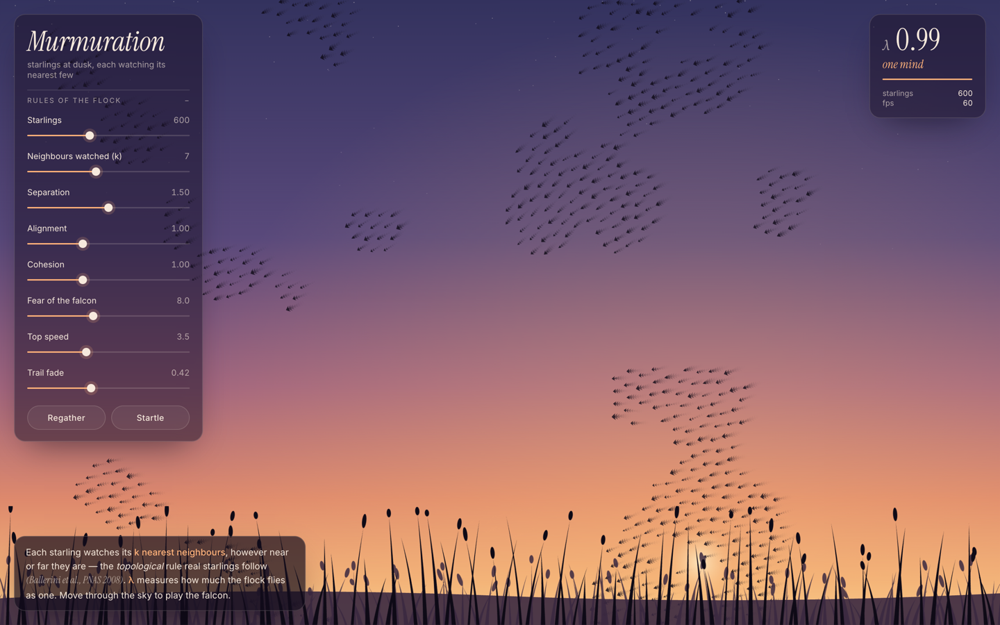

# Murmuration

A real-time starling murmuration simulation in React + TypeScript, running on a 2D canvas: ink-dark starlings at dusk over a reedbed, with your cursor playing the falcon.

  



## Why "topological" boids

Reynolds' original boids model (1987) is brilliant but wrong in one detail: it assumes each bird looks at neighbours within a fixed radius. Ballerini et al. measured actual starling flocks over Rome with stereoscopic photography and found something different — each bird tracks its **~7 nearest neighbours regardless of distance**. This _topological_ rule, not the metric one, is what keeps real murmurations cohesive when density fluctuates and when a falcon scatters them.

This simulation uses topological neighbours by default (configurable via the `k` slider) and a spatial hash grid for O(n) neighbour queries.

## Run

```bash
npm install
npm run dev
```

Open http://localhost:5173.

## Architecture

The code is organised with Domain-Driven Design, in four layers. Dependencies only point inwards, and each layer has a Vite alias.

```
src/
├── domain/          @domain          pure model: no DOM, no React, no clock, no Math.random
├── application/     @application     use cases + DTOs (MurmurationService, repository port)
├── infrastructure/  @infrastructure  adapters: spatial hash, canvas renderer, rAF loop, pointer
├── presentation/    @presentation    React components
└── main.tsx                          composition root: wires adapters to ports
```

**Domain (the Murmuration bounded context).** It is fully immutable and deterministic.

| Concept | Kind | Meaning |
| --- | --- | --- |
| `Murmuration` | aggregate root | The flock, its sky, its rules, the falcon, and its `Seed`. Every behaviour (`advance`, `scatter`, `adopt`, `regather`, `sightFalcon`…) returns a new `Murmuration`. |
| `Starling` | entity | A bird with a stable `StarlingId`. `fly()` returns the same bird a moment later. |
| `Vector2`, `Sky`, `Falcon`, `Seed` | value objects | Geometry, the toroidal sky, the predator, and a pure PRNG (Mulberry32). |
| `FlockingRules` = `Perception` + `Instincts` + `FlightEnvelope` | value objects | The tunable rules. Invariants are checked on construction. |
| `Polarisation` | value object | Vicsek order parameter λ. |
| `steering` | domain service | Separation, alignment, cohesion and evasion as pure functions. |
| `NeighbourhoodIndexer` | domain port | "Who are my k nearest?" `bruteForceIndexer` is the reference specification. |

Randomness is a value. Every draw returns a number and the next `Seed`, so the same seed and the same commands always produce the same flock.

**Application.** `MurmurationService` loads the aggregate from a `MurmurationRepository`, calls one behaviour, and saves the result. Queries return flat DTOs (`Tuning`, `MurmurationView`, `FlockMetrics`), so nothing outside the application layer touches domain objects.

**Infrastructure.** `SpatialHashIndexer` implements the indexer port in O(n) per tick, and the tests check it against the brute-force spec. There is also the canvas renderer, the `requestAnimationFrame` loop, and the window and pointer bindings. Motion trails are a rendering concern, so they live here and not in the domain.

**Presentation.** React holds only slider values and stats sampled at 2 Hz. The flock never enters React state.

### Guard rails

- `tsconfig.core.json` compiles `domain` and `application` without the DOM lib, so `window`, `document` and canvas types don't exist there.
- `tests/architecture.test.ts` uses `import.meta.glob` to enforce the dependency direction and barrel-only imports between layers. It also bans impure calls (`Math.random`, `Date.now`, `performance`, browser globals) in the pure layers.

```bash
npm test          # vitest: domain behaviour, indexer vs spec, architecture
npm run typecheck # app + DOM-free core
```

## The four forces

| Force        | Direction               | Reads          | Notes                                                  |
| ------------ | ----------------------- | -------------- | ------------------------------------------------------ |
| Separation   | away from close neighbours | nearest 7 (default) | Only kicks in within `separationRadius` (18 px)       |
| Alignment    | toward neighbours' avg heading | nearest 7  | Steering force = `avg_v̂ * maxSpeed - self.v`         |
| Cohesion     | toward neighbours' centroid | nearest 7  | Normalised so density doesn't affect strength         |
| Predator     | away from cursor        | mouse           | Inverse-distance, ramped to 0 at `predatorRadius`     |

The order parameter shown in the stats panel is the [Vicsek model](https://en.wikipedia.org/wiki/Vicsek_model) magnetisation: `|⟨v̂⟩|`. Real flocks sit just below 1.0 — slightly off the ferromagnetic ground state, which is what gives them their fluid, ever-shifting look.

## Things to try

- **Crank cohesion to 3** — flock collapses into a tight ball
- **Set separation to 0** — classic Vicsek "moving herd"
- **Drag the cursor slowly through the middle** — watch information propagate as a wave (this matches Cavagna et al.'s measurements of real flocks at ~12 m/s under falcon attack)
- **Drop neighbours to 2** — flock fragments into many small subflocks
- **Drop neighbours to 14** — flock becomes too coupled and oscillates

## References

- Reynolds, C. W. (1987). [Flocks, herds and schools: A distributed behavioral model](https://www.red3d.com/cwr/boids/). _SIGGRAPH '87_.
- Ballerini, M. et al. (2008). [Interaction ruling animal collective behavior depends on topological rather than metric distance](https://www.pnas.org/doi/10.1073/pnas.0711437105). _PNAS_ 105(4).
- Cavagna, A. et al. (2010). [Scale-free correlations in starling flocks](https://www.pnas.org/doi/10.1073/pnas.1005766107). _PNAS_ 107(26).
- Vicsek, T. et al. (1995). [Novel type of phase transition in a system of self-driven particles](https://journals.aps.org/prl/abstract/10.1103/PhysRevLett.75.1226). _Phys. Rev. Lett._ 75.
